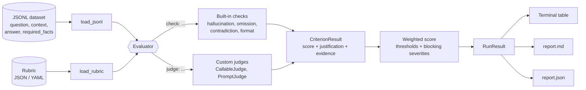

# llm-eval-kit

**Rubric-based, deterministic evaluation of LLM outputs: catch hallucinations, omissions and contradictions with scores you can audit.**

[](https://github.com/s78519300-creator/llm-eval-kit/actions/workflows/ci.yml)
[](https://www.python.org/)
[](LICENSE)


---

## Why

Most teams shipping GenAI features end up evaluating outputs in one of two ways:
eyeballing a spreadsheet, or asking another model for a score. The first does not
scale, and the second is slow, costs money, drifts between runs and is hard to
defend when a stakeholder asks *"why did this answer fail?"*

`llm-eval-kit` takes the approach that works for traditional test automation:

- **Write the quality bar down** as a versioned rubric (criteria, weights, severities, thresholds).
- **Run cheap deterministic checks first.** Token-overlap grounding, required-fact coverage and
  negation/number consistency catch a surprising share of real failures in milliseconds,
  with no API keys and no network.
- **Explain every score.** Each criterion produces a written justification and concrete
  evidence (the exact unsupported sentence, the missing fact, the conflicting number).
- **Plug in an LLM-as-judge only where you need one**, behind the same interface, so
  model-graded and rule-based criteria are scored, weighted and reported the same way.

The result is an evaluation step you can drop into CI and gate releases on.

## Features

| | |
|---|---|
| **Rubrics as data** | Define criteria in JSON (always supported) or YAML (optional `PyYAML`). Typos in keys, check names or params fail fast. |
| **Hallucination check** | Splits the answer into claims and scores each one by unigram + bigram support against the source context. Numbers absent from the source are flagged. |
| **Omission check** | Verifies each required key fact is present (content-word coverage + exact number match). |
| **Contradiction check** | Aligns answer clauses to source sentences and flags polarity flips ("are" vs "are not") and number mismatches ("35 hours" vs "28 hours"). |
| **Format checks** | `json_valid` (with required keys), `length` bounds, `required_keywords`, `forbidden_phrases`. |
| **Pluggable judges** | `BaseJudge` ABC, `CallableJudge` to wrap any function, and `PromptJudge` for model-agnostic LLM-as-judge. Nothing calls the network by default. |
| **Auditable scoring** | Weighted scores, per-criterion thresholds, severity-based blocking failures and a plain-English verdict per sample. |
| **Batch + reports** | Evaluate a JSONL dataset; get a terminal summary plus Markdown and JSON reports. |
| **CI-friendly CLI** | `llm-eval run ... --strict` or `--fail-under 0.9` returns a non-zero exit code. |
| **Zero runtime dependencies** | Pure standard library, Python 3.9+. |

## Architecture



## Quickstart

```bash
git clone https://github.com/s78519300-creator/llm-eval-kit.git
cd llm-eval-kit
pip install -e .            # or: pip install -e ".[yaml]" for YAML rubrics

llm-eval run --dataset examples/qa_dataset.jsonl --rubric examples/rubric.json --out reports/
# equivalently: python -m llm_eval_kit run -d examples/qa_dataset.jsonl -r examples/rubric.json -o reports/
```

### Sample output

This is the actual output for the bundled example dataset: eight grounded Q&A answers,
some faithful, some with planted hallucinations, omissions and contradictions.

```text
Rubric: grounded-qa v1.0  |  samples: 8  |  dataset: examples/qa_dataset.jsonl

SAMPLE             SCORE  RESULT  FAILED CRITERIA
-----------------  -----  ------  ---------------------------
eiffel-tower        1.00  PASS    -
python-gil          1.00  PASS    -
gift-card-refund    0.70  FAIL    consistency*
photosynthesis      0.80  FAIL    completeness*
insulin             0.85  FAIL    groundedness*
headphone-battery   0.68  FAIL    groundedness*, consistency*
boiling-point       0.90  PASS    tone
great-wall          0.55  FAIL    groundedness*, consistency*

CRITERION     WEIGHT  SEVERITY  MEAN  PASSED
------------  ------  --------  ----  ------
groundedness       3  critical  0.81     5/8
consistency        3  critical  0.71     5/8
completeness       2  high      0.83     7/8
conciseness        1  low       1.00     8/8
tone               1  medium    0.88     7/8

Passed 3/8 (37.5%)  |  mean score 0.81  |  pass threshold 0.80
* = blocking criterion (severity: high, critical)

Wrote reports/report.md
Wrote reports/report.json
```

A few things worth noticing:

- `insulin` scores **0.85**, above the 0.80 threshold, but still **fails**: one of its
  claims ("first isolated by Marie Curie in 1935...") is unsupported, and groundedness is a
  critical criterion. A high average never hides a blocking failure.
- `boiling-point` **passes with a warning**: it opens with "I think", which fails the
  medium-severity `tone` criterion, but that only costs it weight.
- `gift-card-refund` reuses the source vocabulary almost word for word, so it looks
  grounded, but the contradiction check catches the flipped polarity.

Each failure comes with its evidence in the Markdown/JSON report, for example:

```text
consistency: Polarity conflict: "Refunds are available for digital gift cards if you request them
             within 30 days of purc..." vs source "Refunds are not available for digital gift cards."
consistency: Number conflict (35 vs 28, 40): "up to 35 hours with noise cancellation turned on."
             vs source "With noise cancellation turned on, battery life is up to 28 hours."
groundedness: Unsupported: "It was first isolated by Marie Curie in 1935 and is now mainly
             synthesised by the kidne..." (support 0.00, numbers not in context: 1935)
```

Other commands:

```bash
llm-eval checks                         # list built-in checks
llm-eval validate examples/rubric.json  # validate a rubric (check names + params)
llm-eval run ... --strict               # exit 1 if any sample fails
llm-eval run ... --fail-under 0.9       # exit 1 if pass rate < 90%
llm-eval run ... --format json -q       # JSON report only, no terminal output
```

## Dataset format

One JSON object per line. Only `answer` is required; common aliases such as
`output`/`response` and `source`/`contexts` are accepted, and unknown fields are kept
as metadata.

```json
{"id": "gift-card-refund",
 "question": "Can I get a refund on a digital gift card?",
 "context": ["Customers can request a full refund within 30 days of purchase. Refunds are not available for digital gift cards."],
 "answer": "Yes. Refunds are available for digital gift cards if you request them within 30 days of purchase.",
 "required_facts": ["refunds are not available for digital gift cards"]}
```

## Rubric example

```json
{
  "name": "grounded-qa",
  "version": "1.0",
  "pass_threshold": 0.8,
  "blocking_severities": ["high", "critical"],
  "criteria": [
    {"id": "groundedness", "check": "hallucination", "weight": 3, "severity": "critical",
     "threshold": 0.75, "params": {"min_support": 0.6},
     "description": "Every claim in the answer is supported by the source context."},
    {"id": "consistency", "check": "contradiction", "weight": 3, "severity": "critical",
     "threshold": 1.0},
    {"id": "completeness", "check": "omission", "weight": 2, "severity": "high",
     "threshold": 0.66},
    {"id": "conciseness", "check": "length", "weight": 1, "severity": "low",
     "threshold": 0.8, "params": {"min_words": 3, "max_words": 60}},
    {"id": "tone", "check": "forbidden_phrases", "weight": 1, "severity": "medium",
     "params": {"phrases": ["I think", "I believe", "I'm not sure", "probably"]}}
  ]
}
```

The same rubric in YAML is in [`examples/rubric.yaml`](examples/rubric.yaml).

### Built-in checks

| Check | What it measures | Params |
|---|---|---|
| `hallucination` | Fraction of answer claims supported by the context | `min_support=0.6`, `ngram=2`, `strict_numbers=true` |
| `omission` | Fraction of required facts present in the answer | `facts` (defaults to the sample's `required_facts`), `min_coverage=0.75` |
| `contradiction` | 1 - (contradicted clauses / aligned clauses) | `min_alignment=0.5` |
| `json_valid` | Valid JSON (code fences tolerated), fraction of required keys | `required_keys` |
| `length` | Within bounds; proportional penalty when outside | `min_words`, `max_words`, `min_chars`, `max_chars` |
| `required_keywords` | Fraction of keywords/phrases present (word-boundary match) | `keywords`, `case_sensitive=false` |
| `forbidden_phrases` | 0 if any forbidden phrase appears, else 1 | `phrases`, `case_sensitive=false` |

## How scoring works

1. **Each criterion** is scored in `[0, 1]` by its check or judge, along with a justification
   and evidence. It **passes** when `score >= threshold`.
2. **The sample score** is the weighted mean: `sum(weight_i * score_i) / sum(weight_i)`.
3. **The sample passes** when both hold:
   - the weighted score is at least the rubric's `pass_threshold`, and
   - no **blocking** criterion failed. A criterion is blocking when its `severity` is in
     `blocking_severities` (default: `high` and `critical`).
4. **A judge that raises** (timeout, malformed reply) is recorded as a failed criterion with
   the error message; it never aborts the batch.

Under the hood, the grounding checks are intentionally transparent:

- Text is tokenised, lower-cased, stripped of stopwords and lightly stemmed; numbers are
  normalised (`1,200` == `1200`).
- **Claim support** = `0.5 * unigram recall + 0.5 * bigram recall` of the claim's content words
  against the context. Unigrams catch invented entities; bigrams catch statements that reuse
  source words in a new combination.
- **Contradictions** are found by aligning each answer clause to the source sentences that
  cover at least `min_alignment` of its content words, then comparing negation cues and numbers.

These are heuristics, not natural-language inference. They are designed to be fast, stable and
explainable so you can run them on every commit, and to sit alongside a model-graded judge
for the subtler cases.

## Extending with a custom judge

Any criterion can name a `judge` instead of a `check`. Judges are passed to the `Evaluator`
by name:

```python
from llm_eval_kit import CallableJudge, Evaluator, PromptJudge, Rubric, load_jsonl

rubric = Rubric.from_dict({
    "name": "support-bot",
    "criteria": [
        {"id": "grounded", "check": "hallucination", "weight": 3, "severity": "critical"},
        {"id": "polite", "judge": "politeness", "weight": 1, "threshold": 0.5},
        {"id": "helpful", "judge": "llm", "weight": 2, "threshold": 0.7,
         "description": "The answer resolves the customer's question."},
    ],
})

# 1) Wrap any function. Return a float, (score, reason), a dict, or a CheckResult.
def politeness(sample, criterion):
    polite = any(w in sample.answer.lower() for w in ("please", "thanks", "happy to help"))
    return (1.0, "Polite phrasing found.") if polite else (0.0, "No polite phrasing.")

# 2) LLM-as-judge: you supply `complete(prompt) -> str`; the judge formats the prompt
#    and parses a "SCORE: 0.8 / REASON: ..." reply. Use any SDK or a local model.
def complete(prompt: str) -> str:
    return my_model_client.generate(prompt)   # your code here

evaluator = Evaluator(rubric, judges={
    "politeness": CallableJudge(politeness),
    "llm": PromptJudge(complete),
})
run = evaluator.run(load_jsonl("data.jsonl"))
```

For full control, subclass `BaseJudge` and implement
`evaluate(sample, criterion) -> CheckResult`. You can also register new deterministic checks
with `@register_check("name")`. See [`examples/custom_judge.py`](examples/custom_judge.py) for a
runnable, offline example.

## Using it as a library

```python
from llm_eval_kit import Evaluator, load_jsonl, load_rubric, render_table, write_reports

run = Evaluator(load_rubric("examples/rubric.json")).run(load_jsonl("examples/qa_dataset.jsonl"))
print(render_table(run))
write_reports(run, "reports/")

for result in run.results:
    for c in result.failed:
        print(result.sample_id, c.criterion_id, c.justification, c.evidence)
```

## Project structure

```text
llm-eval-kit/
├── src/llm_eval_kit/
│   ├── __init__.py      # public API
│   ├── __main__.py      # python -m llm_eval_kit
│   ├── cli.py           # argparse CLI: run / checks / validate
│   ├── rubric.py        # Rubric, Criterion, JSON/YAML loading + validation
│   ├── dataset.py       # Sample model, JSONL loading
│   ├── checks.py        # deterministic checks + registry
│   ├── judges.py        # BaseJudge, CheckJudge, CallableJudge, PromptJudge
│   ├── evaluator.py     # weighted scoring, verdicts, run aggregation
│   ├── report.py        # terminal table, Markdown and JSON reports
│   └── text.py          # tokenisation, sentence/clause splitting, n-grams
├── tests/               # pytest suite (77 tests)
├── examples/
│   ├── qa_dataset.jsonl # 8 realistic grounded Q&A samples
│   ├── rubric.json
│   ├── rubric.yaml
│   └── custom_judge.py
├── .github/workflows/ci.yml
├── pyproject.toml
├── CHANGELOG.md
├── CONTRIBUTING.md
└── LICENSE
```

## Development

```bash
pip install -e ".[dev]"
pytest              # 77 tests, ~95% coverage
ruff check . && ruff format --check .
```

## Roadmap

- [ ] Pairwise comparison mode (model A vs model B on the same rubric)
- [ ] Optional embedding-based support scoring behind an extra
- [ ] Per-claim citation checks for RAG answers (`[1]`, `[2]` style references)
- [ ] Judge calibration helpers: agreement between deterministic checks, LLM judges and human labels
- [ ] HTML report with filtering by criterion and severity
- [ ] Run-to-run diffing to spot regressions between prompt or model versions

## License

[MIT](LICENSE) © 2026 Shalu Kumari

---

Built by **Shalu Kumari**: [LinkedIn](https://www.linkedin.com/in/shalu-kumari-a20616188)
